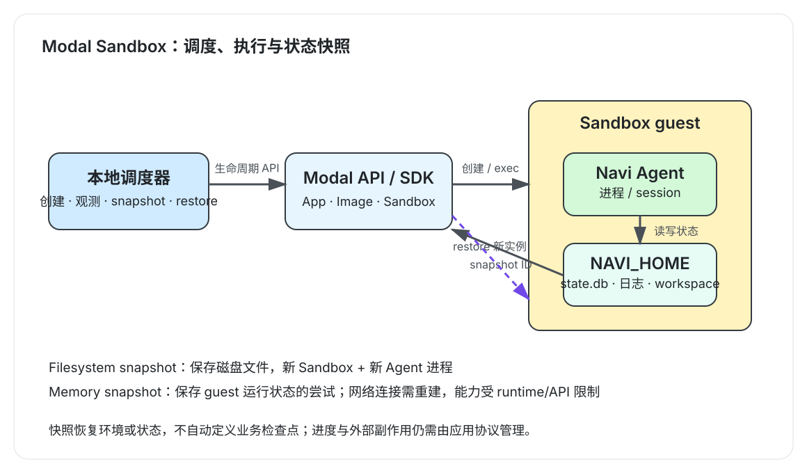

最近想验证一下 Agent Sandbox 的状态快照和恢复功能。

问题：**Sandbox 恢复后，回来的究竟是文件、Agent 会话，还是原来的运行进程？**

## 三种不同的“恢复”

| 恢复对象 | 保存的内容 | 恢复后的含义 |
| --- | --- | --- |
| 环境 | 镜像、依赖和预置文件 | 创建配置相同的新 Sandbox |
| 文件 | workspace、数据库、日志和产物 | 新 Sandbox 从保存的磁盘状态启动 |
| 运行状态 | 进程、内存等 guest 状态 | 在支持的条件下，从快照中的运行状态继续 |

Agent 会话则是应用数据：新进程可以读取旧会话继续交互，但这不表示原进程还在。Modal 提供 gVisor 和 VM 等 Sandbox runtime，也提供文件系统和内存快照等能力；本文实验分别使用了 Navi 文件状态路径和 VM 内存快照探针。[Modal Sandboxes](https://modal.com/docs/guide/sandboxes) · [Sandbox Snapshots](https://modal.com/docs/guide/sandbox-snapshots)

可以把它想成两条不同的恢复路径：文件快照把磁盘上的工作成果交给新实例；内存快照试图保存 guest 当时的运行现场。前者通常会重新启动 Agent，由应用重新读取会话和进度；后者更接近恢复执行环境，但网络连接、外部服务状态和任务副作用并不会因为内存被保存就自动回滚或重连。

## 创建和恢复要分别计时

我用一个不调用模型的常驻探针，记录 guest PID、内存启动标识、内存计数器和磁盘 heartbeat。三次 VM 样本数据如下：

| 样本 | 创建 API | 创建后到 ready | 内存快照 | 恢复 API | 恢复后到 ready |
| --- | ---: | ---: | ---: | ---: | ---: |
| 1 | 3.13 s | 6.62 s | 10.65 s | 1.05 s | 未记录 |
| 2 | 2.58 s | 4.16 s | 7.22 s | 1.39 s | 3.71 s |
| 3 | 2.43 s | 2.48 s | 6.28 s | 2.24 s | 2.15 s |

三次从创建请求到 ready 分别约为 9.76、6.74、4.91 秒。恢复总时间在有完整记录的两次样本中约为 5.10 和 4.39 秒。API 返回不是 Sandbox ready；记录这两个时间点，才能知道环境何时真正可执行。样本只有三次，只能作为这次实验的观测值。

第三次恢复后，guest PID 和内存启动标识与快照前一致，内存计数器从 1 增长到 5，磁盘 heartbeat 也增长到 5。这个探针确实从快照的运行状态继续执行了。

## Navi 文件状态：内容恢复了

接着我让 `navi-agent==0.3.1` 完成一次短任务。Agent 退出后，对 Navi 数据目录做文件系统快照，再从快照创建新 Sandbox，比较文件路径、大小和 SHA-256。

`state.db` 为 233,472 bytes，日志为 571 bytes。恢复后，数据库、日志和 `pending-interactions.json` 的路径、大小、内容 hash 都相同，Agent 退出码为 0。文件快照耗时约 1.18 秒，恢复 Sandbox 的创建 API 耗时约 0.56 秒。

这证明已写入磁盘的状态进入了快照。它没有证明正在运行的 Agent 进程被恢复。

## 新进程能否接着使用旧会话？

我从该文件快照创建新 Sandbox，以相同的 session ID 启动 Navi Agent，并让它复述上一轮请求和回答。它正确复述了内容；`state.db` 从 233,472 bytes 增长到 262,144 bytes，日志也更新。

再从同一份快照启动新进程处理一份三行订单 CSV。Agent 生成汇总脚本和 JSON，结果为 3 笔订单、7 件商品、总金额 200.00；对应产物也出现在恢复后的文件系统中。

因此，Navi 的磁盘会话状态可以被新进程读取并继续使用。日志里的 `session_id` 相同，但 `run_id` 改变：**会话延续了，进程没有延续。**

## 运行中的 Agent 做内存快照

最后，我让 Navi Agent 作为 Sandbox 主命令的子进程运行，由外部调度器发起 memory snapshot，并记录进程 PID、启动和退出标记。

实验中曾观察到快照前 Agent 仍在运行；恢复后出现相同 PID，之后任务写入退出标记并完成。另一次也观察到恢复后进程短暂存活，随后结束。过程中还出现过 Sandbox timeout/terminated，因此这只是有限样本的实际表现，不能推广成所有 Agent 进程都能无损续跑。

Modal 文档指出，内存快照会终止原 Sandbox，恢复会创建新 Sandbox；开放 TCP 连接需要重建，通过 `Sandbox.exec()` 启动的命令仍在运行时不能创建快照，其启动的后台进程也不保证正确恢复。实验中的 Navi 是由 Sandbox 主命令启动的子进程，所以不能把结果解释成 `exec` 后台进程的恢复保证。[Modal Snapshot 限制](https://modal.com/docs/guide/sandbox-snapshots)

## 我的结论

- 文件快照保存已落盘状态；新 Agent 进程能读取旧会话继续工作。
- VM 内存快照探针恢复了原运行状态；Navi 运行中快照也有成功样本，但还不足以保证 Agent 都能无损续跑。
- 可靠恢复需要应用保存检查点，并在恢复后校验副作用。

实验调度脚本和原始 JSON 保存在 `agent-sandbox-practice` 项目中，包含创建与内存快照探针、Navi 文件快照、会话延续、CSV 汇总和运行中快照记录。

**阅读参考：**龙进《AI Agent 执行环境的规模化难题：CubeSandbox 的解法与实践》；林鑫《从沙箱到执行边界：蚂蚁 AI Agent 的大规模企业级实践》；李凯《美团企业级 Agent 的平台化应用实践》。
